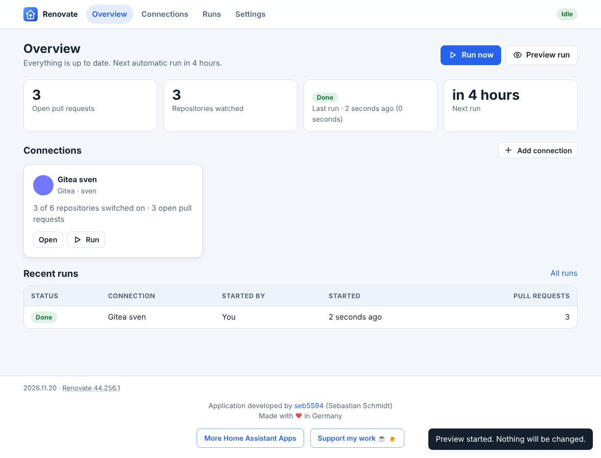
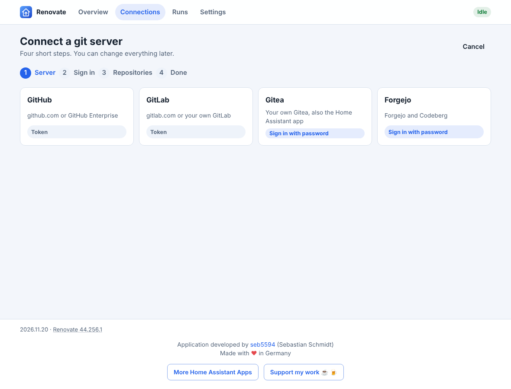
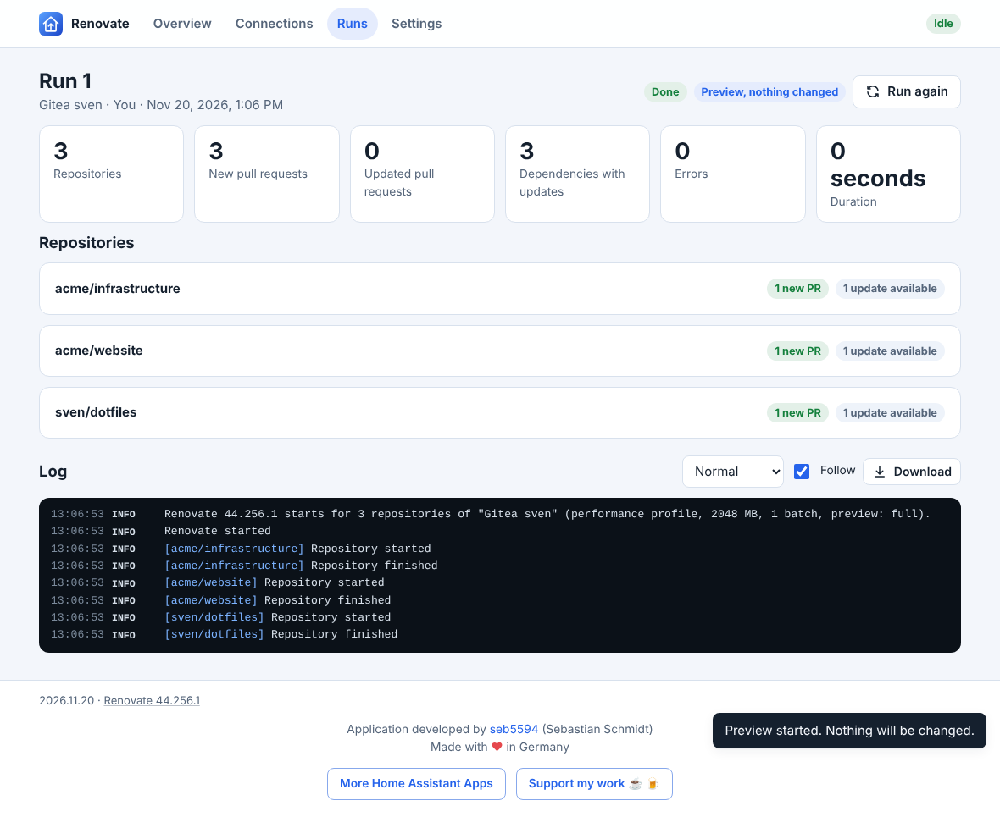
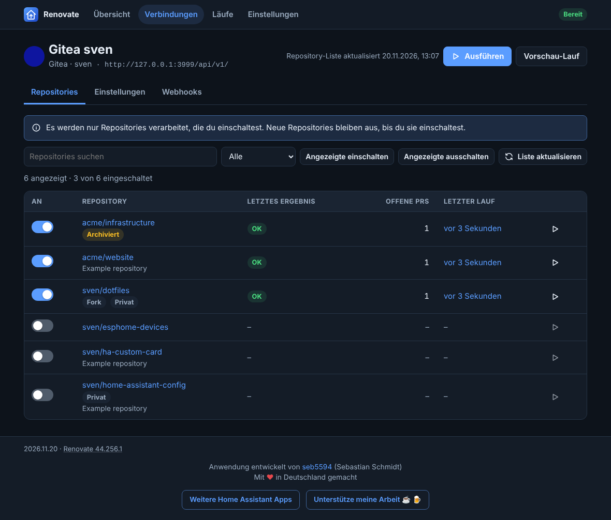

[🇬🇧 English](README.md) · **🇩🇪 Deutsch**

> [!WARNING]
> **Experimentell.** Die App ist neu und wurde gegen einen nachgebauten Git-Server, einen Renovate-Ersatz und die Konfigurationsprüfung des echten Renovate getestet, aber noch nicht auf vielen echten Installationen. Rechne mit Ecken und Kanten und melde bitte, was dir auffällt.

Abhängigkeiten veralten unbemerkt: ein Docker-Tag hier, eine GitHub Action dort, ein Python-Paket in deiner Custom Integration. **Renovate** beobachtet deine Repositories und öffnet einen Pull Request, sobald es von etwas, das du nutzt, eine neue Version gibt. Aus einer lästigen Pflicht wird eine Prüfung. Diese App betreibt Renovate **auf deinem eigenen Home Assistant**, neben deinem eigenen Git-Server, mit einer Weboberfläche ohne Kommandozeile.



## Warum diese App

- **Verbinden in einer Minute.** Wähle deinen Server und melde dich auf dem einfachsten Weg an: per Kurzcode bei GitHub, mit deinem Login bei Gitea und Forgejo (die App erstellt ein Token mit genau den richtigen Rechten, dein Passwort wird nie gespeichert) über eine Anmeldung auf der eigenen Seite des Servers (Passkey, YubiKey, Single Sign-on) oder über eine vorausgefüllte Token-Seite. Die Gitea-App von Home Assistant wird automatisch gefunden.
- **GitHub, GitLab, Gitea, Forgejo, Bitbucket, Azure DevOps, Gerrit und SCM-Manager** in einer App, beliebig viele Konten nebeneinander. Selbst gehostete Server, GitHub Enterprise und Codeberg funktionieren ebenfalls.
- **Sicherer Einstieg.** Ein *Vorschau-Lauf* zeigt, was Renovate tun würde, ohne etwas zu ändern. Repositories schaltest du einzeln ein, und Renovates Pull Request „Configure Renovate“ muss zuerst von dir übernommen werden, bevor es ein Repository anfasst.
- **Gemacht für kleine Geräte.** Ein einziger Node.js-Prozess, der zwischen den Läufen schläft, SQLite statt Datenbankserver, Läufe in kleinen Durchgängen mit Speicherlimit und niedriger CPU-Priorität. Ein Ressourcenprofil wird automatisch nach deinem Arbeitsspeicher gewählt, ein Raspberry Pi ist also genauso willkommen wie ein Mini-PC.
- **Immer das neueste Renovate, exakt gepinnt.** Die Renovate-Version ist im Image festgelegt. Ein neues Renovate-Release hebt die Version an und veröffentlicht automatisch eine neue App-Version. Du bekommst frische Versionen, ohne je ein ungepinntes Image zu betreiben.
- **Ereignisgesteuert, wenn du willst.** Webhooks deines Git-Servers starten einen Lauf eine Minute nach dem Merge eines Pull Requests oder dem Abhaken im Dependency Dashboard, statt auf den Zeitplan zu warten.
- **Teil von Home Assistant.** Sensoren (`sensor.renovate_status`, `sensor.renovate_open_pull_requests`, `sensor.renovate_last_run`), ein Ereignis nach jedem Lauf und optionale Fehlerbenachrichtigungen passen in deine Automationen.
- **Sieht aus, als gehöre sie dazu.** Hell und Dunkel folgen Home Assistant, die Akzentfarbe ist Blau, folgt deinem Home-Assistant-Design oder ist eine Farbe deiner Wahl, und die Oberfläche spricht Deutsch und Englisch.
- **Transparent.** Jeder Lauf hat ein Live-Protokoll, ein Ergebnis pro Repository (neue Pull Requests, gefundene Updates, Probleme) und Hinweise in einfacher Sprache zu den üblichen Fehlern: abgelaufenes Token, Server nicht erreichbar, Zertifikat, Rate-Limit, zu wenig Speicher.
- **Bis ins Detail einstellbar.** Jede Einstellung gibt es in der Weboberfläche *und* in der App-Konfiguration; ein Schloss zeigt, was gewinnt. Verbindungen lassen sich allein in der Konfiguration festlegen.

| | | |
| --- | --- | --- |
|  |  |  |

## Unterstützte Git-Server

| Server | Anmeldung | Hinweise |
| --- | --- | --- |
| GitHub, GitHub Enterprise Server | Code (Device Flow) oder Token | Für die Anmeldung per Code braucht es eine OAuth-App, siehe [Anmeldung per Code einrichten](renovate/DOCS.de.md#mit-code-anmelden-github) |
| GitLab, self-managed GitLab | Token (vorausgefüllte Seite) oder **Browser-Anmeldung** | Die Browser-Anmeldung funktioniert mit Single Sign-on; die App erneuert die kurzlebigen Tokens |
| Gitea | Passwort (erstellt ein Token), **Browser-Anmeldung (Passkey, YubiKey, SSO)** oder Token | Die Gitea-App von Home Assistant wird erkannt |
| Forgejo, Codeberg | Passwort (erstellt ein Token), **Browser-Anmeldung** oder Token | |
| Bitbucket Cloud | Benutzername und API-Token | Beta |
| Bitbucket Server / Data Center | HTTP-Zugriffstoken | Beta |
| Azure DevOps (Services und Server) | Persönliches Zugriffstoken | Beta |
| Gerrit | Benutzername und HTTP-Passwort | Beta, in Renovate experimentell |
| SCM-Manager 3 | API-Schlüssel | Beta, in Renovate experimentell |

Die **Browser-Anmeldung** ist der Weg für Konten, die mit einem Passkey oder einem Sicherheitsschlüssel wie dem YubiKey 5 NFC geschützt sind: Du meldest dich auf der eigenen Seite deines Servers an, wo diese wie gewohnt funktionieren, und die App sieht nie ein Passwort. Sie braucht eine einmalige Registrierung der App auf dem Server und keine öffentliche Adresse, siehe [Browser-Anmeldung](renovate/DOCS.de.md#browser-anmeldung-passkey-yubikey-sso).

Die mit **Beta** gekennzeichneten Server wurden nach der Dokumentation von Renovate gebaut und gegen aufgezeichnete API-Antworten getestet, nicht gegen echte Installationen. Melde bitte, was nicht funktioniert. Sie haben keine Webhooks; der Zeitplan startet ihre Läufe. AWS CodeCommit wird nicht unterstützt: Seine Anfragen brauchen AWS-Signaturen, was eine große Abhängigkeit mitbrächte.

## Schnellstart

1. Füge dieses Repository in Home Assistant hinzu: **Einstellungen → Apps → App-Store → ⋮ → Repositories**, dann `https://github.com/seb5594/Home-Assistant-Apps` einfügen.
2. Installiere **Renovate**, starte es und öffne die Weboberfläche (sie erscheint auch in der Seitenleiste).
3. Klicke auf **Git-Server verbinden** und folge den vier Schritten.
4. Beginne mit einem **Vorschau-Lauf**. Sieht das Ergebnis richtig aus, klicke auf **Jetzt ausführen**.
5. Öffne die Pull Requests „Configure Renovate“ in deinen Repositories und übernimm sie. Ab dann hält Renovate die Repositories aktuell.

Der erste Lauf in einem Repository ohne Konfiguration öffnet nur den Onboarding-Pull-Request. Alles Weitere ändert sich erst nach deinem Merge.

## Verhältnis zu Mend Renovate CE

Mend veröffentlicht einen „Community Edition“-Server für Renovate. Diese App verpackt ihn bewusst **nicht**, aus Gründen, die für dich zählen:

| | Mend Renovate CE | Diese App (Open-Source-Renovate) |
| --- | --- | --- |
| Git-Server | GitHub, GitLab, Bitbucket Server | GitHub, GitLab, **Gitea, Forgejo**; Bitbucket und andere möglich |
| Lizenz | Proprietär, Mend-Nutzungsbedingungen, Lizenzschlüssel nötig | Renovate steht unter AGPL-3.0, die App unter MIT, kein Schlüssel |
| Weitergabe | Das Image darf nicht in andere Images eingebaut werden | Unverändert mit den AGPL-Hinweisen enthalten |
| Basis | Debian-basiertes Image | Alpine, für Home Assistant optimiert |

Was CE zum „Server“ macht (Zeitplan, Warteschlange, Webhooks, Status), ergänzt diese App um das Open-Source-Renovate, du brauchst also kein zweites Produkt. Wenn du auf Funktionen angewiesen bist, die es nur bei Mend gibt (Merge Confidence, Mend Remediate), nutze Mends eigenes Image.

## Leistung und Ressourcen

| Profil | Gewählt für | Parallele Läufe | Speicher pro Lauf | Repositories pro Durchgang | CPU-Priorität |
| --- | --- | --- | --- | --- | --- |
| Sparsam | bis 2 GB RAM, Raspberry Pi | 1 | 512 MB | 3 | 15 (sehr rücksichtsvoll) |
| Ausgewogen | 2 bis 6 GB | 1 | 1 GB | 10 | 10 |
| Leistung | mehr als 6 GB | 2 | 2 GB | 25 | 5 |

- Zwischen den Läufen ist die App ein einziger ruhender Node.js-Prozess mit etwa 80 MB. Es gibt kein Polling: ein Timer wartet auf den nächsten Lauf.
- Renovate läuft nur während eines Laufs, in Durchgängen, sodass Speicher nach jedem Durchgang zurückgegeben wird. Jeder Wert lässt sich überschreiben.
- Die Weboberfläche kommt ohne Framework und Build-Schritt aus: wenige kleine Dateien, einmal komprimiert und vom Browser zwischengespeichert. Seiten aktualisieren sich nur, solange sie sichtbar sind, und nur ein laufender Lauf hält eine Live-Verbindung offen.
- Das Image ist einige hundert MB groß, weil Renovate selbst ohne Entwicklungsdateien umfangreich ist (etwa 185 MB des installierten Pakets).

## Ehrliche Grenzen

- **Experimentell.** Siehe Hinweis ganz oben.
- **Architekturen:** Die App wird wie das Basis-Image für amd64, aarch64, armv7, armhf und i386 gebaut. Der Autor nutzt nur amd64 und aarch64; die 32-Bit-Builds sind ungetestet, und Renovate braucht viel Arbeitsspeicher, auf kleinen Boards ist es also langsam.
- **Pull Requests kommen von dem Konto, das du verbindest.** Nutze für einen sauberen Verlauf ein eigenes „renovate“-Konto. Das Token einer GitHub App oder eines GitLab-Bots lässt sich ebenfalls als Token einfügen.
- **Tokens der Browser-Anmeldung laufen ab**, bei Gitea nach einer Stunde, bei GitLab nach zwei. Die App erneuert sie vor jedem Lauf; widerruft ein Server die Anmeldung, muss die Verbindung neu hinzugefügt werden.
- **Lock-Dateien von Nicht-JavaScript-Projekten** brauchen ihre Werkzeuge. Das Image enthält Node.js, npm und Git; ergänze `python3`, `py3-pip`, `go` und weitere unter *Zusätzliche Systempakete*, wenn deine Repositories sie brauchen. Docker-in-Docker (`binarySource: docker`) steht nicht zur Verfügung.
- **Sicherheitsnetz für reguläre Ausdrücke entfernt.** Renovates optionale `re2`-Engine ist nicht im Image, Renovate nutzt die eingebaute. Das spielt nur eine Rolle, wenn du nicht vertrauenswürdigen Personen erlaubst, die Renovate-Konfiguration deiner Repositories zu ändern.
- **Webhooks brauchen eine erreichbare Adresse.** Ohne öffentliche URL (Reverse Proxy, Tunnel) übernimmt der Zeitplan, was für die meisten Haushalte völlig ausreicht.
- **Sensoren sind keine Registry-Entitäten.** Sie verschwinden beim Neustart von Home Assistant bis zur nächsten Aktualisierung durch die App, die wenige Sekunden nach ihrem Start erfolgt.
- **Ein Benutzer.** Den Zugriff regelt Home Assistant (standardmäßig nur Administratoren). Die App hat keine eigenen Konten.
- **Der Server läuft mit den Rechten des Containers.** Home Assistant hält die App-Konfiguration nur für root lesbar, und die App folgt ihr live. Renovate selbst, das Paketmanager auf deinen Repositories ausführt, startet immer als unprivilegierter Benutzer.

## Updates und Versionen

Die Versionen sind kalenderbasiert: `YYYY.MM.DD` für den ersten Build eines Tages, danach `.1`, `.2` und so weiter. Die gepinnte Renovate-Version und die Alpine-Pakete aktualisiert die Release-Pipeline automatisch; das [Änderungsprotokoll](renovate/CHANGELOG.md) nennt die Änderungen. Fertige Images für beide Architekturen liegen in der GitHub Container Registry.

## Dokumentation

📖 Die [App-Dokumentation](renovate/DOCS.md) listet jede Option und erklärt Anmeldung, Webhooks, Zertifikate, zusätzliche Werkzeuge und Fehlersuche (englisch, eine [deutsche Fassung](renovate/DOCS.de.md) liegt bei).

## Mitmachen

Der Code ist absichtlich klein und zum Lesen geschrieben:

```text
renovate/rootfs/opt/renovate-app/
  server/providers/     eine Datei pro Git-Server
  server/runs/          Warteschlange, Runner, Ressourcenprofile, Auswertung des Berichts
  server/settings/      die Registry, die Prüfung, Oberfläche und Konfiguration steuert
  ui/                   die Weboberfläche (einfache JavaScript-Module, kein Build-Schritt)
tools/                  Dev-Server mit Fake-Gitea, Generatoren für Konfiguration und Bilder
.github/tests/unit/     Tests (node --test), auch im gebauten Image ausgeführt
```

```bash
node --disable-warning=ExperimentalWarning --test '.github/tests/unit/*.test.mjs'
node --disable-warning=ExperimentalWarning tools/dev-server.mjs
```

`tools/sync-config.mjs` erzeugt `config.yaml` und die Übersetzungen aus der Settings-Registry neu; ein Test schlägt fehl, wenn sie abweichen.
